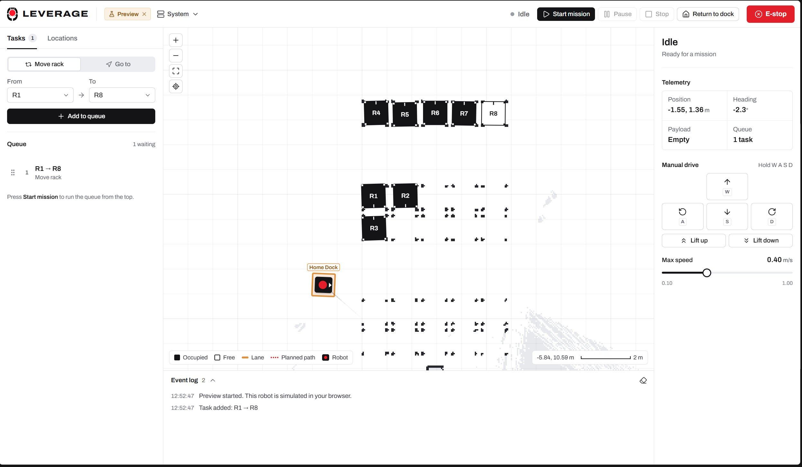
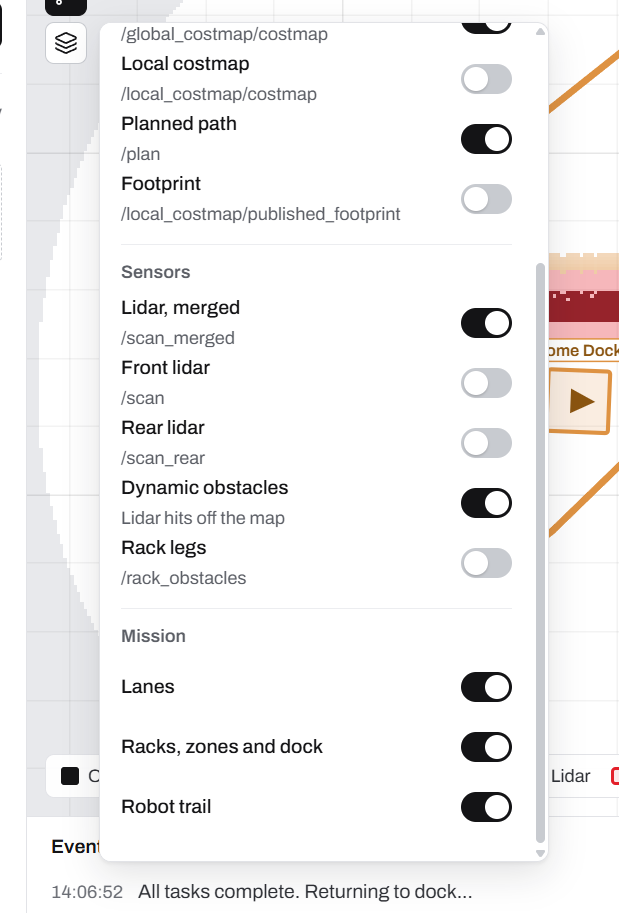
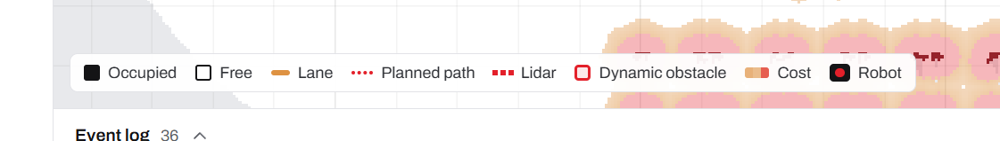
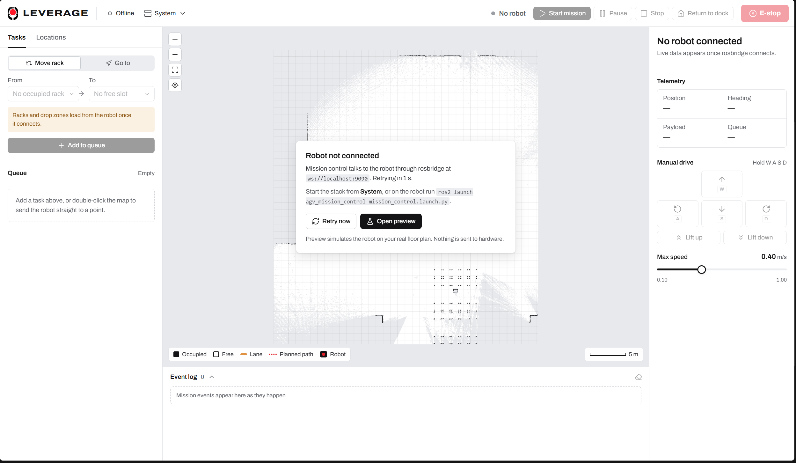
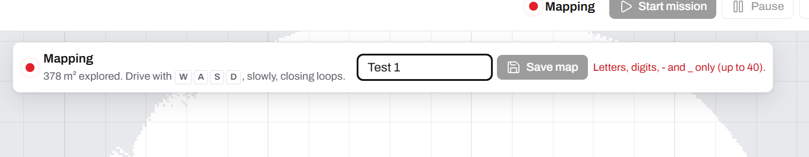
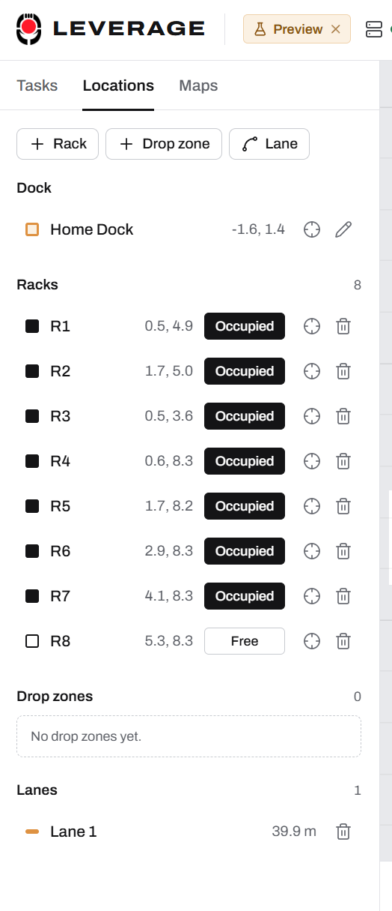
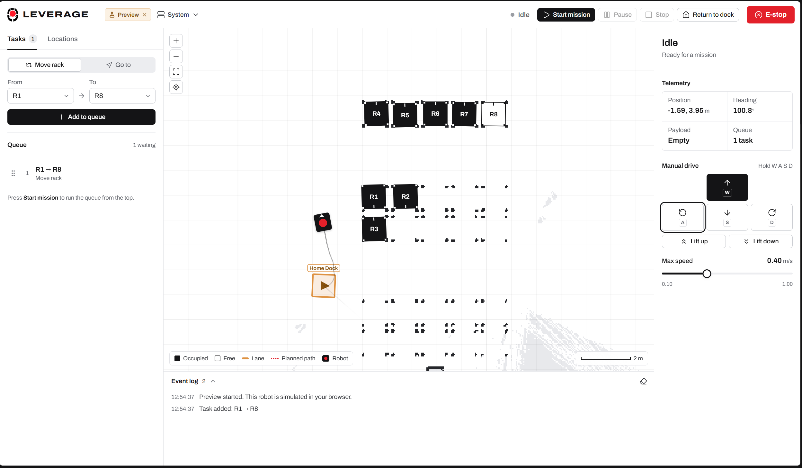

# LEVERAGE AMR: feature reference

Everything the software does, large and small, grouped so it can be presented section by section.
LEVERAGE is a warehouse rack-transport **AMR** (Autonomous Mobile Robot) built for the E-JUST
Graduation Project 2027. It drives under a rack, lifts it, carries it to a free slot and sets it
down, while an operator plans and watches the work in a browser.

How to use each feature step by step: [USER_GUIDE.md](USER_GUIDE.md).

---

## 1. The system at a glance
   
| Layer | What it is | Where |
|---|---|---|
| Mission control GUI | React web app: planning, live map, RViz-style layers, stack launcher, map library and editor | `RaspberryPi_ROS2/src/amr_mission_control/gui` |
| Launcher service | HTTP service that starts/stops the robot stack, RViz and manages saved maps | `amr_mission_control/launcher_server.py` |
| Mission manager | ROS 2 node that runs the transport queue, docking, lift and lane following | `amr_mission_control/mission_manager_node.py` |
| Navigation | slam_toolbox localization, Nav2 (MPPI), edited-map planning | `amr_navigation` |
| Mapping | Dual-lidar scan pipeline, payload filter, SLAM mapping | `amr_mapping` |
| Hardware | CAN bridge (hoverboard + e-stop controller), MPU9250 IMU, two RPLidar A1M8 | `amr_hardware` |
| Simulation | Same stack in Gazebo with `sim:=true` | `amr_description`, `amr_bringup` |
| Motor firmware | Hoverboard FOC firmware with a custom CAN protocol and a configuration tool | `Hoverboard_Firmware` |

**Headline capabilities**

- One browser tab runs the whole robot: launch mapping or navigation, map a site, save and edit
  maps, plan transports, watch every sensor, drive by hand and stop everything.
- No terminal needed after the launcher is started once on the robot.
- A complete in-browser **Preview** simulates the robot, so the GUI can be demonstrated with no
  robot, no ROS and no simulator.
- Lanes are always smooth: every corner and junction is rounded, in the GUI and on the robot.
- Closed-loop docking under racks using the lidar-detected rack legs.

---

## 2. Mission control GUI

### 2.1 Design and visual identity

- **Bespoke design system**, not a template: documented in `gui/DESIGN.md` (art direction, tokens,
  components) and `gui/PRODUCT.md` (audience, jobs, principles).
- **Industrial, calm palette**: near-black ink on warm neutrals, one signal red (`#FF1929`, from
  the E-JUST emblem) reserved for the robot, recording and danger, and one amber for lanes and the
  dock. No purple/blue SaaS gradients, glows or decorative cards.
- **Typography**: Archivo for interface text with tabular figures for every number (positions,
  headings, speeds), so live values never jitter. Monospace only for topics and commands.
- **E-JUST emblem** cropped from the official high-resolution logo, drawn at its true aspect ratio
  (height-driven, never stretched), with a matching favicon.
- **Three-column operator layout**: planning on the left, the live floor plan in the middle, the
  robot on the right; an event log under the map.
- **Motion with purpose**: panel and sheet transitions, queue reordering, step completion and
  toasts use short eased animations (Motion library); everything respects
  `prefers-reduced-motion`.
- **Accessible components** built on Radix primitives: real buttons, labelled icon buttons,
  tooltips, focus rings, keyboard-operable tabs, menus, switches, dialogs and sliders.
- **Responsive**: desktop (three columns), tablet (the Robot panel folds into the left tabs) and
  phone (map on top, one tabbed panel below).
- Quality gates passed: ESLint, production build, Impeccable design detector (no findings), Taste
  lint and inspector (no failures).

### 2.2 Top bar

- LEVERAGE wordmark and emblem.
- **Connection / Preview badge**: shows Offline, Connecting, Connected or Preview; Preview has a
  one-click exit.
- **System button** with a status dot and the running mode and map, for example
  `Navigation · Hang1` or `Mapping`; opens the System sheet.
- **Robot state pill**: Idle, Running, Paused, Navigating, Lifting, Lowering, Returning,
  Completed, Mapping, Emergency stop, or No robot.
- **Mission controls**: Start mission, Pause/Resume, Stop, Return to dock. Each button is enabled
  only when its action is possible (for example nothing can start while mapping).
- **E-stop** always visible in red; while latched it turns into **Release E-stop**, behind a
  confirmation dialog.

### 2.3 Live map (RViz in the browser)

- **World-metre camera** rendered on a canvas with a render loop that reads a live data store, so
  sensor streams never re-render React.
- Pan by dragging, zoom with the wheel or a pinch, zoom buttons, **Fit map** and **Follow robot**
  (switched on automatically while mapping, off as soon as you pan).
- Keyboard: arrow keys pan, `+`/`-` zoom, `0` fits.
- **Double-click** anywhere to send the robot straight to that point.
- **Right-click a rack** to flip it between free and occupied.
- **Robot glyph** with heading arrow, drawn from TF (`map → odom → base_footprint`) and a fading
  **trail** of where it has been.
- **Planned path** drawn dotted from `/plan`.
- **Legend** that lists only what is visible (occupied, free, lane, planned path, lidar, dynamic
  obstacle, cost, robot) and a **scale bar** with the cursor's map coordinates.
- Racks, drop zones and the dock drawn on top of the map with names and free/occupied fills.

### 2.4 Layers menu

Every layer can be switched on or off; each ROS topic is subscribed **only while its layer is on**
(CBOR compression over rosbridge), so the robot's Wi-Fi is not flooded. Choices persist in the
browser.

| Group | Layers |
|---|---|
| Map | Occupancy map (`/map`, `/map_static`), metre grid |
| Navigation | Global costmap, local costmap, planned path, robot footprint |
| Sensors | Merged lidar, front lidar, rear lidar (placed with `/tf`), dynamic obstacles, rack legs (`/rack_obstacles`) |
| Mission | Lanes, racks/zones/dock, robot trail |

- **Costmaps** are drawn with the Nav2 cost colours (lethal, inscribed, inflated) under the scene.

  
  

- **Dynamic obstacles**: lidar hits on free floor, away from mapped walls, are clustered and boxed
  in red, so people and carts stand out from the static map.

  

- A separate **lane toggle** on the map toolbar shows or hides lanes in one click.

### 2.5 System sheet: launching the robot stack

- Choose **Real robot** or **Simulation** (Gazebo).
- Choose **Navigation** on a selected saved map, or **Mapping** a new site.
- **Launch**, **Restart** and **Stop** (stop behind a confirmation). The status line follows the
  stack through Starting, Running and Stopped, polled quickly while it changes.
- **RViz on/off** with the configuration that matches the mode (`navigation.rviz` or
  `mapping.rviz`).
- **Live `ros2 launch` output** streamed into the sheet (colour codes stripped), with process
  sources labelled.
- When no robot is connected, a notice on the map offers the next step directly: launch,
  retry the connection, or open Preview.

  

### 2.6 Mapping a new site

- **Maps → New map** starts SLAM mapping through the launcher.
- A **Mapping bar** floats over the map: recording dot, **explored area in m²** updating live, the
  driving hint with `W A S D` key caps, a map name field and **Save map**.
- **Name validation** inline: letters, digits, `-` and `_`, up to 40 characters; Save stays
  disabled until the name is valid. Saving over an existing name asks before replacing it.

  

- Saving writes both formats at once: the slam_toolbox **pose graph** (for localization) and the
  **image** (`.pgm` + `.yaml`, for planning and the GUI).
- After saving: **Saved ✓**, **Save again**, and **Navigate with <map>**, which restarts the stack
  in navigation on the new map.

  
  

- While mapping, tasks are disabled with a clear explanation (mapping has no navigation).

### 2.7 Map library

- Every saved map with a **thumbnail**, size in metres and "saved … ago".
- Badges: **In use**, **Default**, **Edited**, **No pose graph** (cannot localize).
- One-click **Navigate with <map>**.
- Per-map menu: **Edit**, **Rename**, **Duplicate**, **Set as default**, **Revert edits**,
  **Delete**.
- Delete moves the map to a trash folder and shows a toast with **Undo**; the map in use cannot
  be renamed or deleted.
- Racks, drop zones and lanes are stored per robot and shared by every map.

### 2.8 Map editor

- Paint **walls**, **free floor** or **unknown** onto a saved map, to block no-go areas, erase
  scan noise or close gaps.
- **Brush** and **straight line** tools, brush size 0.05–1.5 m with a live cursor ring.
- **Undo/redo** (40 steps), unsaved-changes indicator, discard confirmation on close.
- Shortcuts: `B` brush, `L` line, `1`/`2`/`3` wall/free/unknown, `[`/`]` size, `Ctrl+Z`,
  `Ctrl+Shift+Z`/`Ctrl+Y`.
- The original scan is kept (`<name>.orig.pgm`), so **Revert edits** always restores it.
- Saved edits are what the **global planner uses** next time navigation starts on that map
  (served on `/map_static`), while localization keeps using the pose graph.

### 2.9 Planning: tasks and queue

- Two task types: **Move rack** (from an occupied rack to a free rack or drop zone) and
  **Go to** (any location).
- The pickers only offer valid choices: occupied sources, free destinations.
- **Queue** with drag-to-reorder, remove with an inline confirmation, and a waiting count.
- **Live mission steps** for the active task: Drive to, Align under rack, Lift rack, Carry to,
  Insert into slot, Lower rack, with a progress bar.
- Empty states explain the next action (for example "double-click the map to send the robot
  straight to a point").

### 2.10 Locations: racks, drop zones, dock and lanes

- Add **racks** and **drop zones**, and edit the **dock**, with a small form: type the
  coordinates or press **Pick on map**, then click and drag on the map to set position and
  heading in one gesture.
- Each row shows coordinates, a free/occupied toggle, **Show on map** (centres the map on it) and
  delete (with an inline confirmation).
- **Lanes**: draw a corridor point by point (Undo point, Finish, Cancel); the list shows each
  lane's length.

  

### 2.11 Smooth lanes (no sharp points)

- Every bend inside a lane and every **junction where lanes meet** is drawn and driven as a
  rounded arc (`lane_corner_radius` 0.6 m, capped at half the shorter neighbouring segment).
- New lane ends **snap** onto nearby lanes and crossings get a shared junction point, so lanes
  really connect in the routing graph.
- The robot follows the whole rounded route as **one** Nav2 `FollowPath` goal instead of stopping
  at every point, with an automatic fallback to point-by-point goals.
- The GUI and the robot use the **same smoothing algorithm** (verified sample-for-sample).

### 2.12 Robot panel

- State headline and sentence ("Idle · Ready for a mission").
- **Telemetry**: position, heading, payload, queue length, in tabular figures.
- **Hold-to-drive pad** (`W` forward, `S` back, `A`/`D` turn), working with mouse, touch,
  keyboard and **`W A S D` from anywhere in the app** (not while typing or in a dialog).
- **Lift up / Lift down**.
- **Max speed** slider (0.10–1.00 m/s) for autonomous driving.

### 2.13 Event log and feedback

- Collapsible **event log** with timestamps and a count; clear button.
- **Toasts** for results and errors, with actions such as Undo.
- Confirmation dialogs for every destructive or safety action: stop stack, discard edits,
  replace map, delete map, release E-stop.

### 2.14 Preview mode (no robot, no ROS)

- Open `http://localhost:5173/?preview` or press **Open preview**.
- A full simulated robot computer runs **inside the browser**: mission manager (A* and lane
  routing, transports with every step), launcher (mapping/navigation, logs, RViz state), a map
  library kept in the tab, simulated lidar by ray-casting, **SLAM that reveals the map as you
  drive**, global and local costmaps, rack legs, footprint and a **person crossing an aisle** as a
  dynamic obstacle.
- Nothing is ever sent to hardware. Ideal for demos, presentations and GUI development.

### 2.15 Fleet workspace (several robots, one laptop)

- **Fleet | Robot ▾** switch in the top bar; the robot menu opens any robot's console, whose top
  bar shows the fleet map and whether the robot has the same copy and layout.
- **Automatic discovery**: robots announce themselves (UDP beacon); new ones wait for first-time
  setup (Robot ID, ROS domain); duplicate IDs and shared domains are flagged.
- **3D floor** (React Three Fiber): the map printed on paper, real walls extruded, racks as ink
  frames that ride on the robot when carried, gold lane tape with one-way arrows, each robot's
  chassis with the red disc, reserved floor, planned paths and back-off paths.
- **Traffic card, holds and back-offs** explained in words ("AMR-03 holds for AMR-01: paths cross").
- **Dispatch** to the best free robot with the reason shown; **Pause / Dock / E-stop all**.
- **Robot settings** stored on the robot: ID, name, speed, traffic priority, ROS domain, notes.
- **Map sync** matrix (same copy / different / missing / running) and **live map editing**.
- **Layout tab**: lanes drawn like a schematic (snap to nodes, link, close loops, open ends, drag
  and delete nodes, one-way lanes) and racks / drop zones with their **face** aimed at a lane.
- **Set up a new Raspberry Pi** over SSH from the GUI, with a live log; **Deploy code** later.

---

## 3. Robot software (ROS 2 Jazzy)

### 3.1 Launcher service (`launcher_server.py`)

- Standard-library Python HTTP service on port 8088 (`AMR_LAUNCHER_PORT`), always on.
- Starts the stack in its own process group and stops it cleanly (SIGINT, then escalation).
- Endpoints for status, logs, launch, stop, RViz, and the map library (list, image download and
  upload, save from SLAM, rename, duplicate, set default, revert, delete, restore).
- Saved maps live in `src/amr_navigation/maps` (`AMR_MAPS_DIR`); deleted maps go to
  `~/.ros/amr_map_trash`; the default map and last choices are in `~/.ros/amr_launcher.json`.
- Migrates the old `~/.ros/agv_*` files and honours old `AGV_*` variables after the AMR rename.

### 3.1b Fleet manager (`fleet_server.py`, laptop)

- Standard-library HTTP service on port 8090; rosbridge link to every robot in the fleet.
- **Traffic control** at 5 Hz: path reservations, holds with a heartbeat lease (a robot that loses
  the laptop holds), "in the way goes first", back-off along the lane or up a rack spur, refuges
  (under an occupied rack when empty, a free slot when carrying), hold-loop breaker, deadlock and
  stuck-behind-parked reports.
- Relays every robot's footprint to the others on `/fleet/peers` (`fleet_layer` in both costmaps).
- **Map library** with fingerprints, pull/push and live edits (robots reload via
  `map_server_static/load_map`); one shared **layout** with rack occupancy kept in sync.
- **Pi setup over SSH** (`provision.py`): hostname + mDNS, ROS 2 Jazzy, workspace upload and
  build, Robot ID, `amr-launcher` boot service, laptop key, password change; **deploy** updates.

### 3.2 Mission manager

- JSON command interface on `/mission_control/command` (add/remove/reorder tasks, start, pause,
  resume, stop, E-stop and release, return to dock, navigate to, locations, teleop, lift, speed).
- **Nine-step rack transport**: lower inflation, navigate to staging, dock, lift, extract, carry,
  insert, drop, retreat.
- **Closed-loop docking** on the lidar-detected rack legs (2–4 legs, rigid fit of centre and yaw),
  with back-off and retry if still off-centre, and stiction breakaway.
- **Carried-payload filter**: the rack legs under the lifted rack are masked from both lidars so
  the robot does not "cage itself" and SLAM does not bake ghost obstacles.
- Occupied racks published on `/rack_obstacles` so the planner keeps out of them.
- Per-phase footprint and inflation switching.
- Locations stored in `~/.ros/amr_locations.json`, outside the workspace, so rebuilds never wipe
  them.
- Lane routing with smooth `FollowPath` execution (section 2.11).
- E-stop latches the hardware e-stop through the CAN bridge; release is refused while the
  physical button is pressed.

### 3.3 Navigation and mapping

- slam_toolbox mapping and localization from a serialized pose graph.
- Nav2 with the MPPI controller and a velocity smoother.
- **Edited-map planning**: `use_edited_map:=true` (default) serves the saved image on
  `/map_static` and points the global costmap at it, so painted walls and no-go areas are obeyed.
- Dual-lidar pipeline: per-lidar filters, payload filter, scan merger into `/scan_merged`.
- EKF fusing wheel odometry and the IMU.
- Every launch file targets the real robot by default; `sim:=true` runs the same stack in Gazebo
  with RViz.

### 3.4 Hardware drivers

- **CAN bridge**: per-wheel rpm commands, hall-tick odometry, battery/temperature/status, e-stop
  controller (STM32F411) that switches the hoverboard's power relay; custom messages
  `HoverboardStatus` and `SafetyStatus`.
- MPU9250 IMU driver with a Madgwick filter.
- Two RPLidar A1M8 scanners (front and rear).
- Teleoperation TUI (`rich_teleop_tui`) for driving from a terminal.

---

## 4. Motor controller firmware

- Based on hoverboard-firmware-hack-FOC with a new **`VARIANT_CAN`** (default build).
- **AMR CAN protocol** (1 Mbit/s): per-wheel speed commands, latched e-stop broadcast with active
  braking, 50 Hz odometry and motion frames, 10 Hz status with battery, temperature, errors and a
  heartbeat.
- Register-level bxCAN driver with automatic bus-off recovery and a clock-tolerant bit timing.
- Machine-readable **DBC file** for every frame, verified with `cantools`.
- **Hoverboard Firmware Tool**: a desktop GUI to choose the variant, edit `config.h` safely, build,
  upload over ST-Link, erase/unlock and open a serial monitor.

---

## 5. Engineering details worth mentioning

- GUI sensor data flows through a mutable live store read by the render loop, not React state, so
  the UI stays fluid while lidars stream.
- A TF buffer in the browser composes `map → odom → base_footprint` and places each lidar scan
  with its own frame.
- Topic subscriptions follow the visible layers; turning a layer off unsubscribes it.
- The lane smoothing in JavaScript mirrors the Python implementation exactly.
- The launcher is dependency-free (standard library only) and keeps the stack in its own process
  group, so a stop never leaves stray nodes behind.
- Edited map images are written through a temporary file and swapped in atomically; the original
  scan is copied aside first and never overwritten.
- The whole project uses the AMR naming (`amr_*` packages, `AMR_*` variables, `~/.ros/amr_*`),
  with automatic migration from the earlier AGV names.
