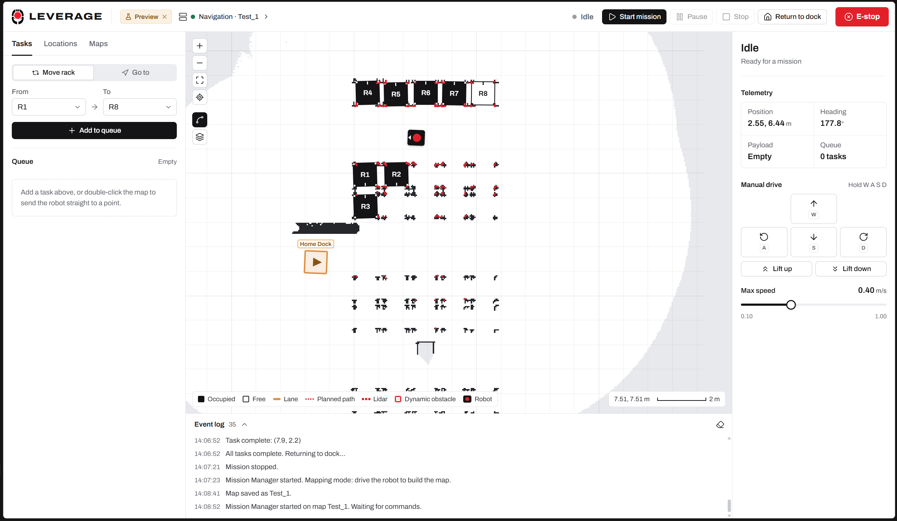
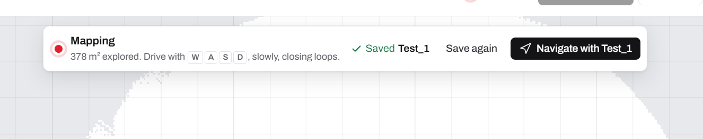
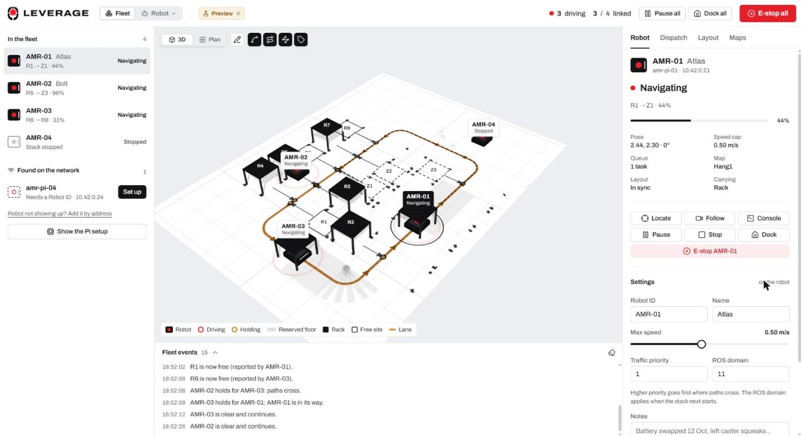
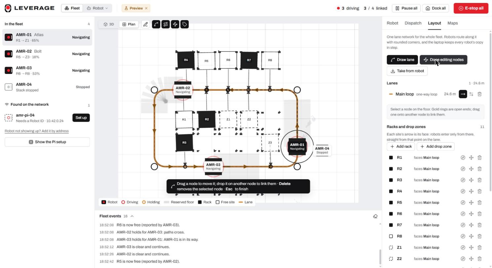

# Graduation Project 2027: Software Development

This directory contains the software developed for **LEVERAGE**, the E-JUST graduation project
AMR (Autonomous Mobile Robot) that transports warehouse racks. It brings together the hoverboard
motor-controller firmware and the Raspberry Pi ROS 2 robot framework with its web mission control.



| Document | For |
|---|---|
| [FEATURES.md](FEATURES.md) | Every feature, large and small, grouped for presentation |
| [USER_GUIDE.md](USER_GUIDE.md) | Step-by-step: setup, mapping, maps, lanes, missions, safety, troubleshooting |
| [RaspberryPi_ROS2/README.md](RaspberryPi_ROS2/README.md) | Robot software: packages, launch files, architecture |
| [RaspberryPi_ROS2/docs/fleet.md](RaspberryPi_ROS2/docs/fleet.md) | Fleet management: several robots from one laptop, traffic rules, Pi setup over SSH |
| [Hoverboard_Firmware/README.md](Hoverboard_Firmware/README.md) | Motor controller firmware and CAN protocol |

## Mission control at a glance

One browser tab runs the robot: launch mapping or navigation, map a site and save it, edit maps,
plan rack transports on smooth lanes, watch costmaps and lidars like in RViz, drive by hand and
stop everything. A built-in **Preview** simulates the robot in the browser, so the interface can
be tried with no robot or ROS (`npm run dev` in `RaspberryPi_ROS2/src/amr_mission_control/gui`,
then open <http://localhost:5173/?preview>).

| Map a new site | Save it and navigate with it |
|---|---|
|  |  |

| Edit maps | Rounded lanes and junctions |
|---|---|
|  |  |

| Launch the stack, RViz and logs | Costmaps, lidars and dynamic obstacles |
|---|---|
|  |  |

### Fleet

A **Fleet** workspace runs several robots from one laptop (`fleet_server.py`): robots are found on
the network automatically, shown on a 3D floor, kept apart by traffic control (path reservations,
holds, backing off along the lane, refuges), and share one map library and one lane layout. A new
Raspberry Pi is set up from the GUI over SSH: hostname, ROS 2 Jazzy, workspace upload and build,
Robot ID and a launcher that starts at boot. Robots drive on lanes only and enter every rack from
its face, straight in at 90° to the lane. Preview simulates the whole fleet.

| Four robots on a one-way loop | Lanes as a schematic, racks with their faces |
|---|---|
|  |  |

## Projects

### Hoverboard firmware

[`Hoverboard_Firmware/`](Hoverboard_Firmware/) contains STM32 firmware for controlling the hoverboard motors using field-oriented control (FOC). The project includes a CAN variant for differential-drive AMR control, with per-wheel speed commands and motor/vehicle status reporting.

- Main documentation: [Hoverboard Firmware README](Hoverboard_Firmware/README.md)
- CAN message definitions: [hoverboard_can.dbc](Hoverboard_Firmware/docs/hoverboard_can.dbc)
- CAN settings and firmware configuration: [Inc/config.h](Hoverboard_Firmware/Inc/config.h)
- Default PlatformIO build variant: `VARIANT_CAN`

Build and upload using the PlatformIO extension or CLI from the firmware directory. The firmware's ST-Link upload configuration is defined in `platformio.ini`.

### E-stop controller (Blackpill)

[`STM32_CANbus_Embedded/Blackpill_CAN_Software/`](STM32_CANbus_Embedded/Blackpill_CAN_Software/README.md) is the firmware of the BODY node: a WeAct Blackpill (STM32F411CEU6) with an MCP2515 CAN controller. It is the robot's e-stop authority. It switches the relay that powers the hoverboard board, reads the e-stop button, trips when the Pi stops sending commands, and reports `SAFETY_STATUS` on the bus. **Blackpill Tool.bat** builds it, uploads over SWD (ST-Link) or USB DFU, and has a serial terminal with a live status panel.

### Raspberry Pi ROS 2 framework

[`RaspberryPi_ROS2/`](RaspberryPi_ROS2/) contains the ROS 2 AMR framework that runs on the robot's Raspberry Pi 5. Its packages cover the robot description, hardware drivers (CAN bridge to the hoverboard board and the e-stop controller, MPU9250 IMU, two RPLidar A1M8), mapping, localization, navigation, teleoperation, and web-based mission control. Every launch file targets the real robot by default; `sim:=true` runs the same stack in Gazebo with RViz.

- Main documentation: [ROS 2 README](RaspberryPi_ROS2/README.md)
- Launch files and workflows: [docs/launch.md](RaspberryPi_ROS2/docs/launch.md)
- Mission control and GUI: [docs/mission_control.md](RaspberryPi_ROS2/docs/mission_control.md)
- Hardware setup on the Pi 5: [docs/hardware.md](RaspberryPi_ROS2/docs/hardware.md)

On the robot:

```bash
cd RaspberryPi_ROS2
bash install_dependencies.sh            # add --sim on a development PC
source /opt/ros/jazzy/setup.bash
colcon build --symlink-install
source install/setup.bash
ros2 launch amr_navigation navigation.launch.py              # add sim:=true for Gazebo + RViz
```

Run the dependency installer once per machine. Source the ROS and workspace setup files in each new terminal before running ROS commands.

To run everything from the GUI instead, start the launcher and the GUI once after boot and open `http://<robot-ip>:5173` ([USER_GUIDE.md](USER_GUIDE.md#3-start-the-robot-and-open-the-gui)):

```bash
python3 src/amr_mission_control/launcher_server.py
cd src/amr_mission_control/gui && npm run dev -- --host
```

> **Renamed from AGV to AMR.** Packages are now `amr_*`. Machines that built the old workspace need `rm -rf build install log` before `colcon build`; saved locations and maps are migrated automatically ([details](USER_GUIDE.md#18-upgrading-from-the-old-agv-names)).

## Software relationship

The ROS 2 framework provides the robot-level navigation and mission-control software. The hoverboard firmware provides low-level motor control and describes its CAN interface in the DBC file. The `amr_hardware/can_bridge` node implements that protocol on the Raspberry Pi. The robot is a differential drive: one mainboard (CAN node 1) drives the two hub motors on the centre axle, and four casters sit at the corners. An STM32F411CEU6 on the same bus is the e-stop controller: it switches the relay that powers the hoverboard board and will later also drive the lift, lights and buzzer. Odometry, telemetry and the e-stop state are published as ROS topics. The bridge has not yet been validated on the assembled robot; follow the first-drive checklist in [docs/hardware.md](RaspberryPi_ROS2/docs/hardware.md).

## Requirements at a glance

- **ROS 2 framework:** Ubuntu 24.04 with ROS 2 Jazzy (Raspberry Pi 5 on the robot); the project installer handles the ROS packages, hardware driver dependencies and GUI dependencies.
- **Hoverboard firmware:** PlatformIO with the STM32 platform and an ST-Link for uploading to the target board. The firmware repository also provides a Python/Tkinter configuration and build GUI.
