# LEVERAGE AMR — ROS 2 software (Raspberry Pi 5)

ROS 2 Jazzy software for the warehouse rack-transport AMR (Autonomous Mobile Robot): a
differential-drive robot (two hoverboard
hub motors on the centre axle driven by one hoverboard mainboard over CAN, four corner casters) with
two RPLidar A1M8 scanners, an MPU9250 IMU, an STM32F411 e-stop controller that switches the
hoverboard's power, and a rack lift.
It covers the robot description, hardware drivers, mapping, localization, Nav2 navigation, and a
web-based mission control GUI that also launches the stack, maps sites and manages maps.

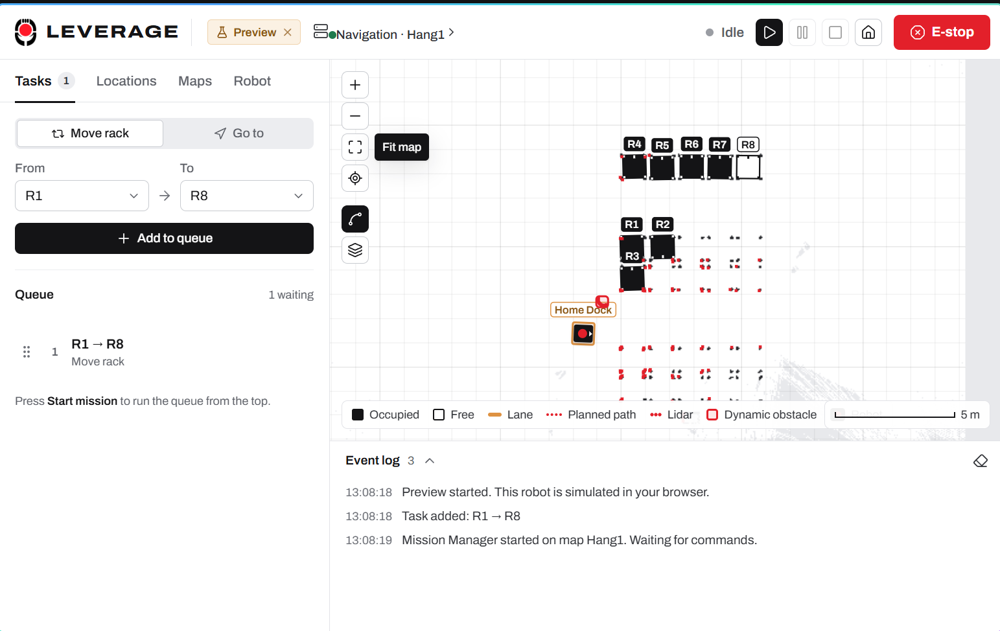

Feature list for presentations: [../FEATURES.md](../FEATURES.md). Step-by-step usage:
[../USER_GUIDE.md](../USER_GUIDE.md).

**Every launch file targets the real robot by default.** Add `sim:=true` to run the same stack in
Gazebo and open RViz instead.

| Command | Real robot (Pi 5) | `sim:=true` (laptop) |
|---|---|---|
| `ros2 launch amr_bringup bringup.launch.py` | drivers + EKF | Gazebo + spawn + bridge + EKF + RViz |
| `ros2 launch amr_mapping mapping.launch.py` | bringup + SLAM mapping | same in Gazebo + RViz |
| `ros2 launch amr_navigation navigation.launch.py` | bringup + localization + Nav2 | same in Gazebo + RViz |
| `ros2 launch amr_mission_control mission_control.launch.py` | mission manager + rosbridge + GUI server | same on the sim clock, opens the browser |

## Quick start

On the robot (Raspberry Pi 5, Ubuntu 24.04 + ROS 2 Jazzy):

```bash
bash install_dependencies.sh            # once per machine, then log out/in
colcon build --symlink-install
source install/setup.bash

ros2 launch amr_navigation navigation.launch.py              # terminal 1
ros2 launch amr_mission_control mission_control.launch.py    # terminal 2
# GUI: http://<robot-ip>:5173 from any machine on the network
```

On a development PC with the simulation:

```bash
bash install_dependencies.sh --sim
colcon build --symlink-install
source install/setup.bash

ros2 launch amr_navigation navigation.launch.py sim:=true
ros2 launch amr_mission_control mission_control.launch.py sim:=true
```

**Everything from the GUI.** Start the launcher service and the GUI once after boot; navigation,
mapping, RViz and the map library are then driven from the browser:

```bash
python3 src/amr_mission_control/launcher_server.py          # port 8088
cd src/amr_mission_control/gui && npm run dev -- --host     # http://<robot-ip>:5173
```

**No robot at all?** `npm install && npm run dev` in `src/amr_mission_control/gui`, then open
<http://localhost:5173/?preview>: the robot, SLAM, lidars and costmaps are simulated in the browser.

**Several robots.** The laptop runs the fleet manager and the GUI; each robot runs the stack and
`launcher_server.py` (installed as the `amr-launcher` service by the GUI's Pi setup). See
[docs/fleet.md](docs/fleet.md).

```bash
pip install paramiko                                    # laptop, once (Pi setup over SSH)
python3 src/amr_mission_control/fleet_server.py         # laptop, port 8090
cd src/amr_mission_control/gui && npm run dev           # Fleet workspace
```

Hardware setup (CAN bus, lidar ports, IMU wiring) must be done once before the first real-robot
launch: see [docs/hardware.md](docs/hardware.md).

> **Renamed from AGV to AMR.** All packages are now `amr_*`. After pulling, run
> `rm -rf build install log` and rebuild. On first start the mission manager and launcher migrate
> `~/.ros/agv_locations.json`, `~/.ros/agv_launcher.json` and `~/.ros/agv_map_trash` to their
> `amr_` names, and the old `AGV_MAPS_DIR` / `AGV_LAUNCHER_PORT` variables still work.

## Mission control GUI

A bespoke React interface (design notes in `src/amr_mission_control/gui/DESIGN.md`): planning on
the left, the live floor plan in the middle, the robot on the right.

| | |
|---|---|
| 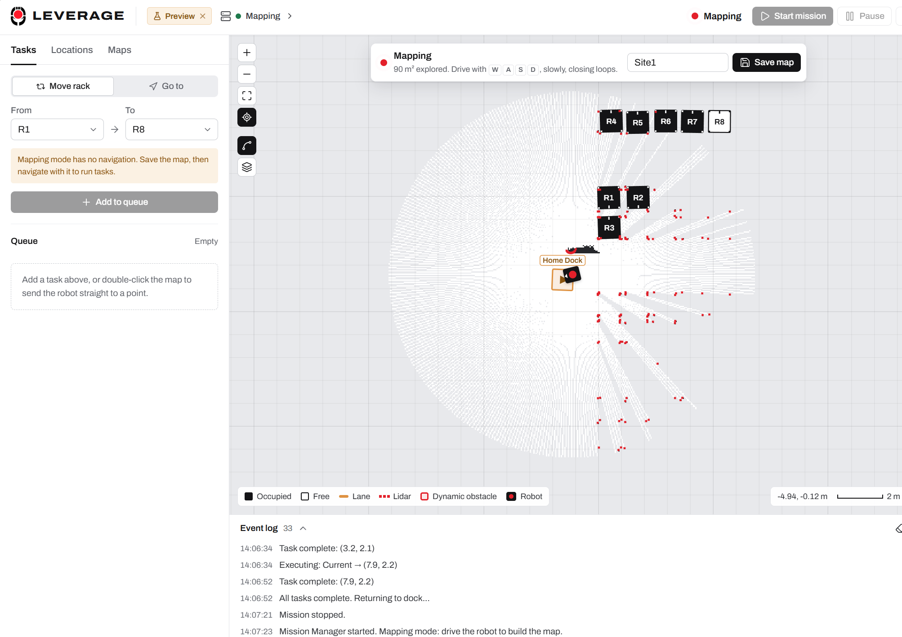 **Mapping.** Maps → New map, drive with `W A S D`, watch the explored area grow, save under a name. | 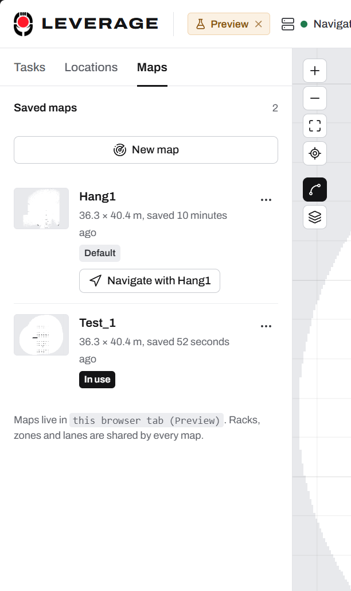 **Map library.** Navigate with, edit, rename, duplicate, set default, revert, delete with Undo. |
| 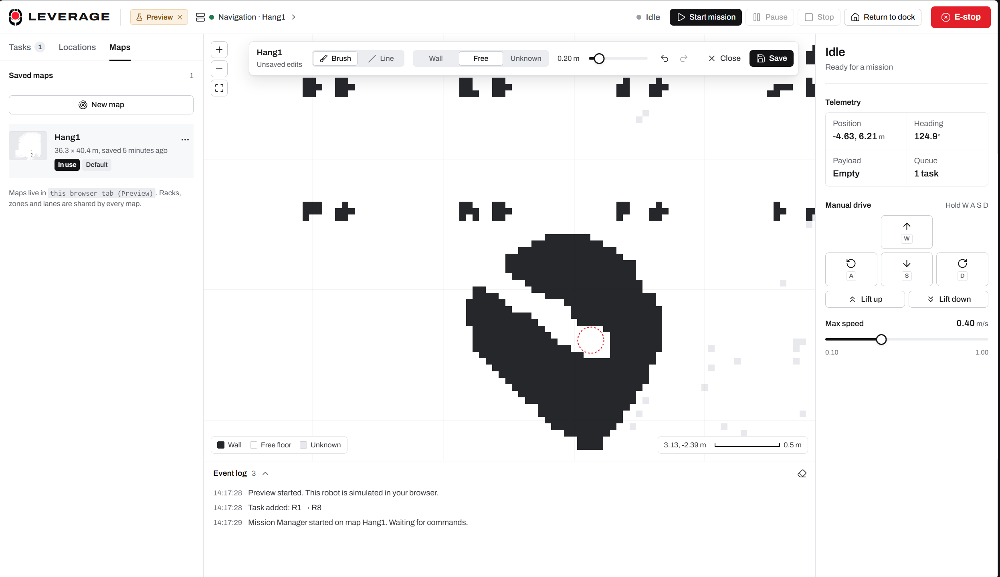 **Map editor.** Paint walls, free floor or unknown; the planner uses the edits (`/map_static`). | 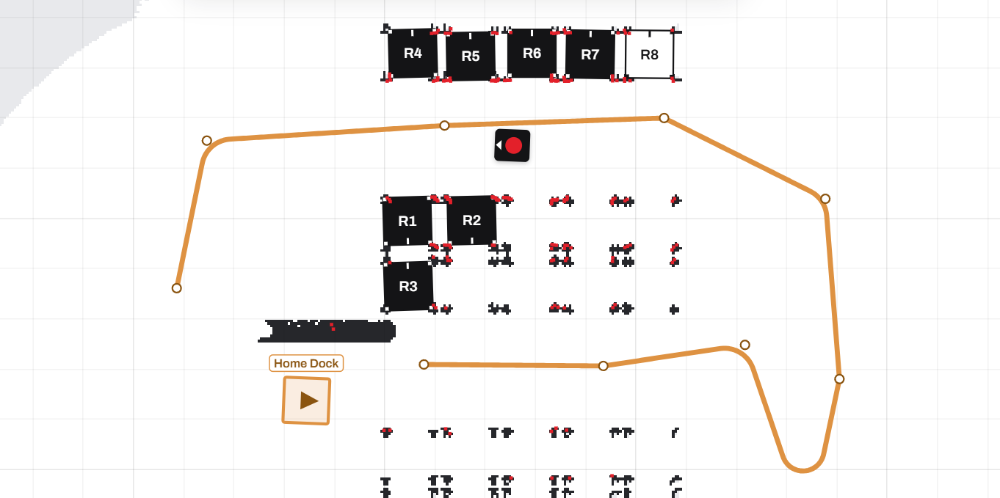 **Smooth lanes.** Corners and junctions are rounded and followed as one `FollowPath` curve. |
| 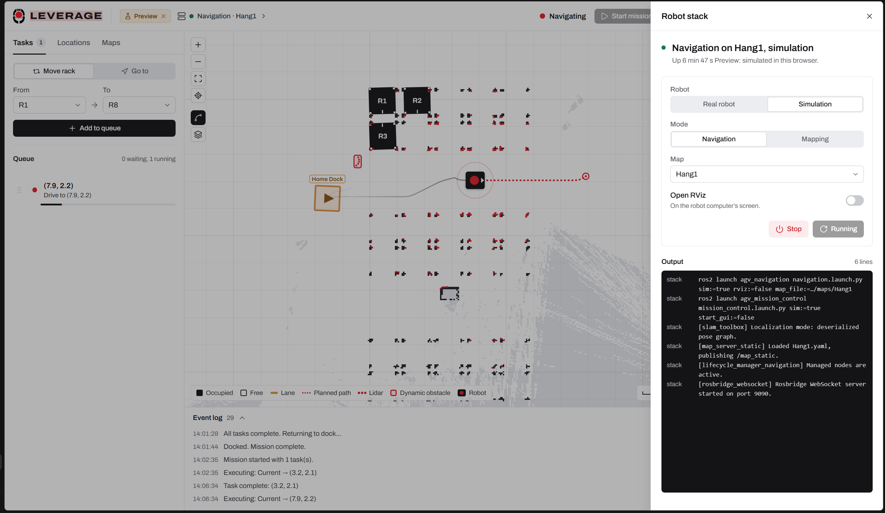 **System.** Real robot or simulation, navigation or mapping, RViz on/off, live `ros2 launch` output. | 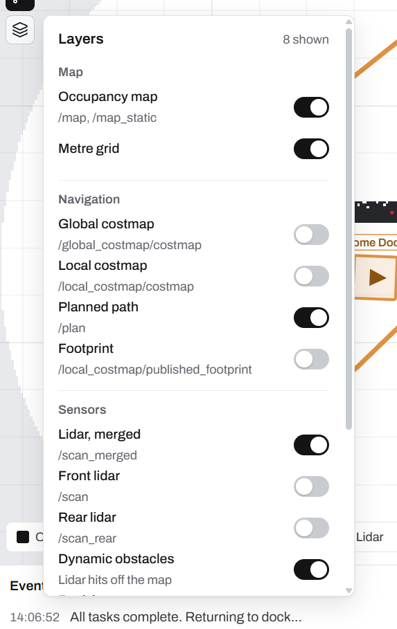 **Layers.** Costmaps, path, footprint, lidars, dynamic obstacles, rack legs, lanes, trail. |
| 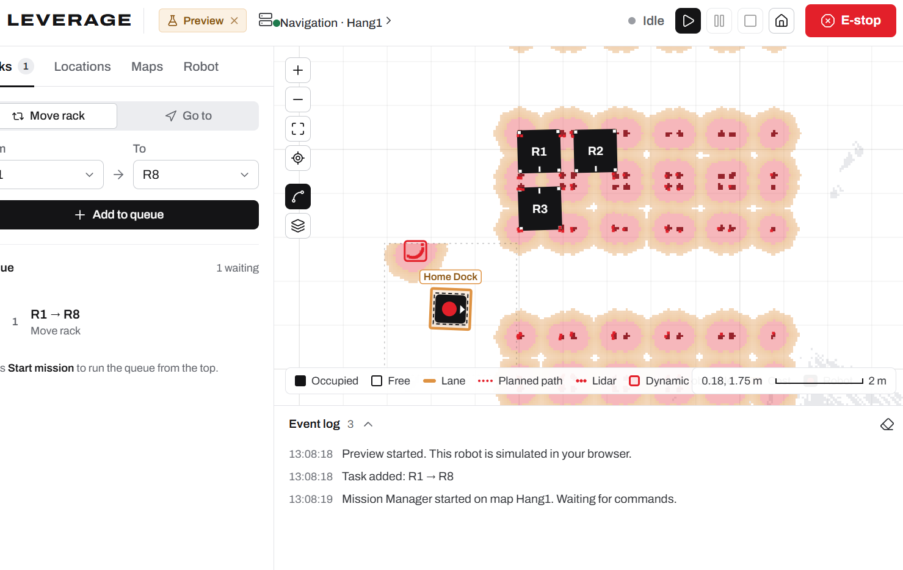 **Costmaps** in Nav2 colours. | 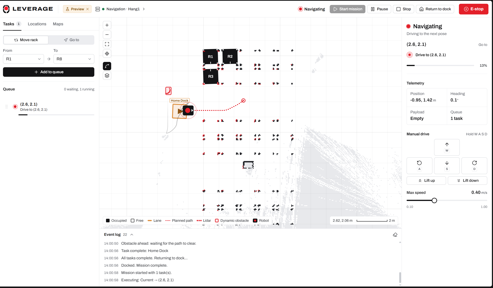 **Dynamic obstacles** boxed in red; double-click to go to a point. |
| 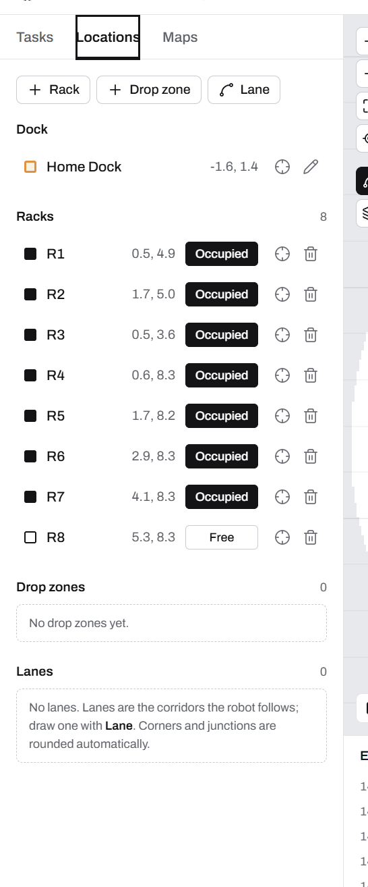 **Locations.** Dock, racks, drop zones, lanes. | 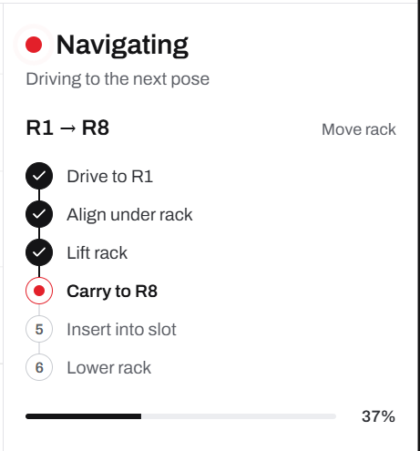 **Missions.** Each transport step, live. |

Details: [docs/mission_control.md](docs/mission_control.md#gui) and
[../USER_GUIDE.md](../USER_GUIDE.md).

## System overview

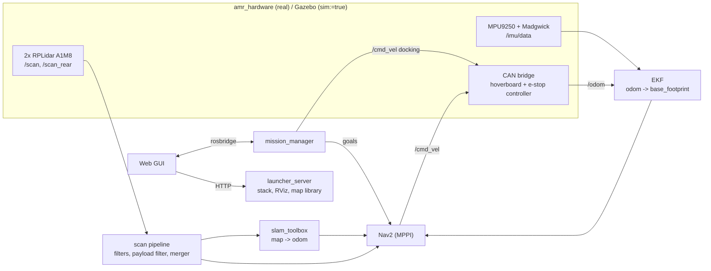

## Packages

| Package | Contents |
|---|---|
| `amr_description` | URDF/Xacro (dual lidar, IMU, differential drive with casters, lift), meshes, Gazebo models and worlds, URDF viewer |
| `amr_interfaces` | Custom messages (`HoverboardStatus`, `SafetyStatus`) |
| `amr_hardware` | Real-robot drivers: CAN bridge (hoverboard + e-stop controller), MPU9250 driver, RPLidar + IMU filter launch |
| `amr_bringup` | Base bringup (real or Gazebo), EKF, Gazebo bridge config, teleop TUI |
| `amr_mapping` | Dual-lidar scan pipeline (filters, payload filter, scan merger), SLAM mapping |
| `amr_navigation` | SLAM Toolbox localization + Nav2 config, saved maps, navigation launch |
| `amr_mission_control` | Mission manager node, React/Vite GUI, launcher service (stack control, map library, robot identity), fleet manager and Pi setup over SSH (`fleet_server.py`, `provision.py`, `map_bundle.py`) |

## Documentation

| Document | Contents |
|---|---|
| [../FEATURES.md](../FEATURES.md) | Every feature of the GUI, robot software and firmware, for presentations |
| [../USER_GUIDE.md](../USER_GUIDE.md) | How to use everything, step by step |
| [docs/launch.md](docs/launch.md) | Every launch file and argument, day-to-day workflows, mapping a new site, multi-machine setup |
| [docs/hardware.md](docs/hardware.md) | Raspberry Pi 5 setup, CAN bus, hoverboard board, e-stop controller, lidars, IMU, first-drive checklist |
| [docs/ros_interfaces.md](docs/ros_interfaces.md) | All topics, services, TF frames and parameter files |
| [docs/mission_control.md](docs/mission_control.md) | Mission manager, GUI, closed-loop docking and payload filter design |
| [docs/fleet.md](docs/fleet.md) | Fleet manager: discovery, traffic control, lanes and rack faces, map sync, Pi setup over SSH |
| [docs/troubleshooting.md](docs/troubleshooting.md) | Known issues, fixes and their history |
| [docs/AMR_Software_Documentation.tex](docs/AMR_Software_Documentation.tex) | Formal report of the docking redesign |

The motor controller firmware and its CAN protocol live in
[../Hoverboard_Firmware](../Hoverboard_Firmware/README.md)
([hoverboard_can.dbc](../Hoverboard_Firmware/docs/hoverboard_can.dbc)).
