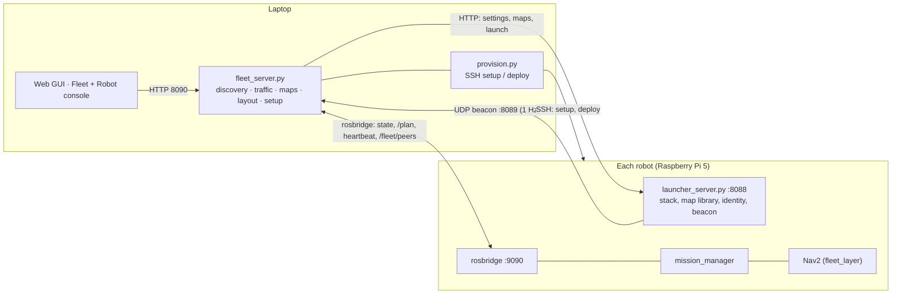

# Fleet management

Several robots, one laptop. The laptop runs the **fleet manager** (`fleet_server.py`); each robot
runs its own stack and `launcher_server.py`, from an identical copy of this repository. Robots never
talk to each other directly: the laptop sees all of them and relays what each needs to know.

## Architecture

| Port | Where | What |
|---|---|---|
| 8088 | robot | `launcher_server.py`: stack control, map library, `/api/robot` identity and settings |
| 8089/udp | laptop | discovery: every launcher broadcasts a beacon once a second |
| 8090 | laptop | `fleet_server.py` HTTP API (and the built GUI, if `gui/dist` exists) |
| 9090 | robot | rosbridge, opened by the laptop to each robot in the fleet |
| 5173 | laptop | GUI dev server (`npm run dev`) |

Start on the laptop: `python3 src/amr_mission_control/fleet_server.py`, then the GUI. The laptop
needs Python 3 and, for setting up Pis, `pip install paramiko`; it does not need ROS (it reaches
the robots over rosbridge, not DDS, which also avoids DDS over Wi-Fi).

## Identity

Every robot runs the same repository. What makes it itself lives outside the workspace in
`~/.ros/amr_robot.json`: Robot ID (e.g. `AMR-03`), name, ROS domain, max speed, traffic priority,
notes. The fleet keys a robot by its **machine key** (`/etc/machine-id`), so renaming a robot keeps
its history; duplicate IDs (or SD-card clones) are flagged. A robot with no ID is *new*: it shows
under **Found on the network** until it is set up, and nothing is sent to a robot that has not been
added to the fleet. Set an ID on the robot with `launcher_server.py --set-id AMR-03`, from the setup
dialog, or as part of the SSH setup below.

Give each robot its own **ROS domain**: robots sharing a domain on one Wi-Fi mix their topics. The
launcher exports `ROS_DOMAIN_ID` to everything it starts; the fleet warns about shared domains.

## Setting up a Raspberry Pi from the GUI

**Fleet › Set up a new Raspberry Pi** turns a fresh Pi with Ubuntu Server 24.04 into a fleet robot
over SSH (`provision.py`). Enter its address, user and password; the laptop shows what it found
(Ubuntu version, board, memory, whether ROS is installed) and you choose the Robot ID, hostname
(defaults to the ID in lower case), name, ROS domain and optionally a new password. One job then:

1. sets the **hostname** and installs avahi, so the Pi answers to `amr-03` and `amr-03.local`;
2. installs **ROS 2 Jazzy** if missing, the official way (`ros2-apt-source` package, `ros-jazzy-ros-base`, `ros-dev-tools`);
3. uploads this workspace (sources only: no `build/ install/ log/`, no `node_modules`, no
   simulation-only Gazebo models; Windows line endings converted; scripts executable);
4. runs `install_dependencies.sh` and `colcon build --symlink-install --parallel-workers 2`;
5. sets the Robot ID and installs `launcher_server.py` as the **`amr-launcher` systemd service**
   (starts at boot; a sudoers rule lets the laptop restart it without a password);
6. installs the laptop's SSH key (`~/.ros/amr_fleet/id_rsa` on the laptop) for later deploys;
7. changes the login password, if asked (last, so the installer keeps its sudo);
8. waits for the robot's launcher, applies name and domain, and adds it to the fleet.

A first setup takes 30–60 minutes on a Pi. The job runs on the laptop: the sheet can be closed and
reopened, the log streams live. The password is kept in memory for the job only. While the job runs
the user gets temporary password-less sudo (`/etc/sudoers.d/amr-provision`), removed at the end.

**Deploy code** (robot inspector) repeats upload → build → restart for a robot that is already set
up, over the laptop key. The robot's stack must be stopped first (the launcher restarts).

## Traffic control

The laptop runs traffic control at 5 Hz (`fleet_server.py`; the same rules run in the browser
Preview, `gui/src/lib/traffic.js`).

- **Reservations.** Each driving robot claims the next few metres of its Nav2 path (`speed × 5 s`,
  1.2–4 m). Claims closer than both robots' radii plus 0.15 m conflict.
- **Who goes first.** A robot standing in the other's path goes first (a leader before its
  follower, a robot waiting on a lane before the one that must drive along it). Otherwise the
  traffic priority setting, then a robot carrying a rack, then whoever started driving first.
- **Hold.** The other robot holds: `mission_manager` cancels its Nav2 goal, stops, and re-sends the
  same goal (or the rest of the lane curve) when released. The task continues. Holds ride on a
  heartbeat (`fleet_heartbeat`, ttl 2 s); a robot that stops hearing from the laptop holds in place.
  Docking, lifting and the straight in/out moves are never interrupted.
- **Back off.** Head-on (each in the other's way): the robot with the shorter way out reverses
  along the lane to the nearest spot clear of the other's whole route and waits there; a robot in
  a site's spur backs up its spur instead. If the lane can't clear it, it takes a **refuge**: an
  empty robot drives in under an occupied rack, a carrying robot only into a free location; sites
  in another robot's task are never used.
- **Loops and deadlocks.** A circle of holds (A waits for B, B for C, C for A) gives one robot
  right of way: the highest-ranked whose way is clear of every robot's body; if it doesn't move
  within 4 s another is tried. Two robots that still block each other are reported for the
  operator to drive one aside; a robot stuck behind a parked one gets a **Dock** button.
- **Awareness.** Each robot gets the others' footprints on `/fleet/peers` (PointCloud2 in its own
  `base_footprint` frame) and marks them in both costmaps (`fleet_layer` in
  `amr_navigation/config/navigation.yaml`), so it plans around robots its lidar can't see yet.

**One-way lanes** prevent head-on meetings entirely and are the recommended setup for loops: a lane
marked one-way is only driven in the order of its points (arrows on the floor); the mission
manager's lane graph respects it.

## Lanes and sites: driving rules

With lanes defined, a robot drives on them and nowhere else during a task:

1. out of a rack slot or the dock **straight back along that site's axis** to the lane;
2. along the lanes (rounded corners, one-way respected) from where it stands to the target's
   **entry point**;
3. squares up on the spot and drives **straight in**.

Every rack, drop zone and dock has a **face**: the arrow opposite its heading. Where that arrow
meets the lane is the entry point; the robot leaves the lane exactly there, at 90° to the lane when
the face was aimed at it. In **Layout › Racks and drop zones** each site shows which lane it faces;
*Face the next lane* aims it square at another lane, *Move* re-places it (aimed at the nearest
lane). A site that isn't square to a lane is flagged.

Lanes are drawn like a schematic: points snap onto existing nodes (the lanes link there), clicking
the lane's own first point closes a loop, each end can be connected or left open. **Edit nodes**
shows every node as a handle: drag to move, drop on another node to link them, Delete to remove.

## Maps and layout

- **Map library** on the laptop (`~/.ros/amr_fleet/maps`) with content fingerprints (yaml without
  the image line, image, pose graph). Pull a map from a robot, push it to others; a robot running a
  map can't have it replaced until its stack stops. Traffic control only compares robots on the
  same copy of a map.
- **Live map editing**: paint walls / free floor / unknown on the fleet floor; Save writes the
  library copy and sends the image to every robot with that copy. A robot navigating on it reloads
  it immediately (`map_server_static/load_map`); the pose graph is untouched, so localization
  carries on.
- **Shared layout**: one set of lanes, racks and drop zones (with occupancy) for the fleet, kept
  in sync on every robot; a robot that moves a rack reports the new occupancy and the others follow.

## Files

| Laptop | |
|---|---|
| `src/amr_mission_control/fleet_server.py` | fleet manager (HTTP 8090, discovery, traffic, maps, layout, setup jobs) |
| `src/amr_mission_control/provision.py` | SSH setup and deploy jobs |
| `src/amr_mission_control/map_bundle.py` | map bundles and fingerprints (shared with the launcher) |
| `~/.ros/amr_fleet/fleet.json`, `layout.json`, `maps/`, `id_rsa` | registry, shared layout, library, deploy key |

| Robot | |
|---|---|
| `launcher_server.py` | identity (`/api/robot`), beacon, map bundles, live map reload |
| `mission_manager_node.py` | fleet hold / heartbeat / back-off, strict lane driving, one-way lanes |
| `~/.ros/amr_robot.json` | Robot ID and settings |
| `amr-launcher.service` | systemd unit installed by the setup |

## Status

Everything above runs in the browser Preview and the laptop/robot code paths are unit-tested
(traffic: 15 scenarios; map sync and editing against a local launcher). Not yet run on the real
robots: Nav2 reversing along a lane for a back-off (MPPI `vx_min` is -0.3), the in-place turn and
straight moves at lane feet, `fleet_layer` with real peers, the rosbridge link from the laptop, the
SSH setup on a real Pi, and an empty robot fitting under a rack as a refuge.
