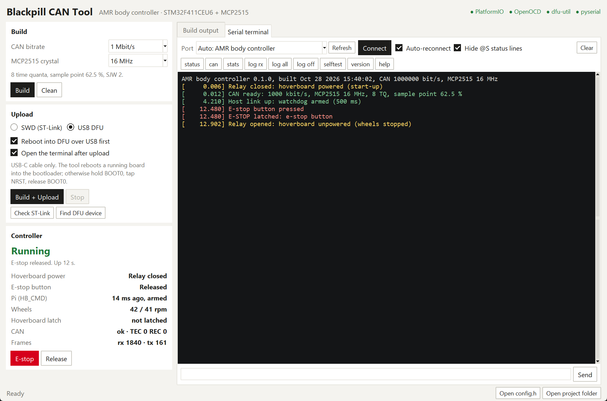

# Blackpill CAN Software: AMR body controller

Firmware for the **BODY** node of the LEVERAGE AMR: a WeAct Blackpill (STM32F411CEU6) with an
MCP2515 CAN controller. It is the robot's **e-stop authority**. It switches the relay that powers the
hoverboard motor board, reads the physical e-stop button, watches the Raspberry Pi, and reports its
state on the CAN bus. The lift, lights and buzzer will be added to the same board later.

The project builds with PlatformIO (Arduino / STM32duino). **Blackpill Tool.bat** opens a small desktop
tool that builds, uploads over **SWD** (ST-Link) or **USB DFU**, and has a serial terminal with a live
status panel.



- [Hardware and wiring](#hardware-and-wiring)
- [Blackpill Tool](#blackpill-tool)
- [Building and uploading without the tool](#building-and-uploading-without-the-tool)
- [What the firmware does](#what-the-firmware-does)
- [Debug console](#debug-console)
- [CAN bitrate and the MCP2515 crystal](#can-bitrate-and-the-mcp2515-crystal)
- [Configuration](#configuration)
- [Testing](#testing)
- [Project layout](#project-layout)
- [Status](#status)

## Hardware and wiring

Pinout reference: [../Docs/Blackpill_Pinout.jpg](../Docs/Blackpill_Pinout.jpg).

| Signal | Blackpill pin | Notes |
|---|---|---|
| MCP2515 SCK / MISO / MOSI | PA5 / PA6 / PA7 | SPI1, 8 MHz |
| MCP2515 CS | PA4 | |
| MCP2515 INT | PB0 | Reserved. The firmware polls over SPI, so it is optional |
| Relay (hoverboard power) | PB12 | HIGH = closed. **Fit a pull-down on the relay driver**, so the relay stays open while the MCU is in reset or being flashed |
| E-stop button | PB13 | Normally-closed contact to GND, internal pull-up. Pressed **or a broken wire** reads as pressed |
| Status LED | PC13 | On-board blue LED |
| USB-C | PA11 / PA12 | Debug console (USB CDC) and DFU uploads |
| SWD | PA13 (SWDIO), PA14 (SWCLK), GND, 3V3 | ST-Link uploads and debugging |

- **MCP2515 module supply.** Common blue modules run the MCP2515 and TJA1050 from 5 V. At 5 V the
  MCP2515's input-high threshold is above the Blackpill's 3.3 V outputs, which is out of spec even
  though it often works on the bench. For the PCB, run the MCP2515 from 3.3 V (it supports 2.7–5.5 V)
  with a 3.3 V transceiver such as the SN65HVD230, or level-shift SCK, MOSI and CS.
- **Termination.** Fit 120 Ω only at the two physical ends of the bus.
- **LED.** It flickers fast when the CAN controller is missing, blinks at 2 Hz while the e-stop is
  latched, and gives a short heartbeat flash while running.

## Blackpill Tool

Double-click **`Blackpill Tool.bat`** or run `python tools/blackpill_gui.py`. The tool needs Python 3
with tkinter and PlatformIO, installed with the VS Code PlatformIO extension. The terminal uses
PlatformIO's own Python (pyserial). dfu-util and OpenOCD come with PlatformIO.

| Area | What it does |
|---|---|
| **Build** | Choose the CAN bitrate and the MCP2515 crystal, and see the resulting bit timing (unreachable combinations are refused). **Build** and **Clean**. Both settings are written to `platformio.ini`. |
| **Upload** | **SWD (ST-Link)** runs PlatformIO's upload. **USB DFU** builds, sends `dfu` to the running firmware so it reboots into the STM32 bootloader (no BOOT0 needed), waits for the bootloader, then flashes with dfu-util. **Check ST-Link** and **Find DFU device** test the connection. After an upload the terminal opens automatically. |
| **Build output** | Live, coloured output of every command, with hints for the usual problems: missing ST-Link or driver, WinUSB for DFU, a COM port in use, an impossible bitrate. |
| **Serial terminal** | Finds the controller by USB ID (or pick a port), reconnects after resets and uploads, keeps command history (↑/↓), and has one-click commands (`status`, `can`, `stats`, `log`, `selftest`, …). |
| **Controller panel** | Live state from the firmware's `@S` lines: e-stop and cause, relay, button, Pi link, wheel speed, hoverboard latch, CAN error counters, frame counts. It also has **E-stop** and **Release** buttons. |

**First DFU upload on Windows.** The STM32 bootloader (USB `0483:DF11`, "STM32 BOOTLOADER")
needs the WinUSB driver once. Put the board in DFU mode (hold BOOT0, tap NRST, release BOOT0),
run [Zadig](https://zadig.akeo.ie), select the device and install **WinUSB**. A board with no
firmware yet always has to be put in DFU mode by hand like this; after that the tool reboots it
over USB.

## Building and uploading without the tool

```bash
pio run                          # build (env: blackpill)
pio run -t upload                # upload over SWD with an ST-Link
pio run -e blackpill_dfu -t upload   # upload over USB DFU (board already in DFU mode)
pio device monitor               # debug console (any baud rate)
```

The same environments appear in the VS Code PlatformIO sidebar.

## What the firmware does

The behaviour follows the e-stop controller specification in
[RaspberryPi_ROS2/docs/hardware.md](../../RaspberryPi_ROS2/docs/hardware.md#e-stop-controller-stm32f411ceu6-body-node).
The frames are defined in
[hoverboard_can.dbc](../../Hoverboard_Firmware/docs/hoverboard_can.dbc).

**Trip.** The e-stop latches on any of these:
- `ESTOP = 1` (0x010) from the Pi.
- The e-stop button (debounced 20 ms).
- No `HB_CMD` (0x201) for **500 ms**, which means the Pi or the CAN bridge has died. This watchdog
  arms on the first `HB_CMD`.

A trip by the button or the watchdog is broadcast as `ESTOP = 1`, so the hoverboard brakes at once.
The first cause is kept.

**Brake, then cut power.** The relay stays closed while the hoverboard brakes; an unpowered board
would let the motors coast. It opens when either:
- both wheels are at or below 5 rpm for 150 ms, measured from the hoverboard's motion frame
  (0x281); or
- motion frames stop for 200 ms; or
- 1.5 s have passed, whatever the wheels are doing.

While the relay is still closed, `ESTOP = 1` is sent again whenever the hoverboard's status frame
(0x381) says it is not latched.

**Release.** Only on `ESTOP = 0` from the Pi, and **never while the button is pressed**. The relay
then closes and the hoverboard reboots. The watchdog re-arms on the next `HB_CMD`.

**Report.** `SAFETY_STATUS` (0x011) goes out at 10 Hz and immediately on any change. Byte 0
holds: bit 0 e-stop active, bit 1 relay closed, bit 2 button pressed, bits 4–6 the cause (0 none,
1 host request, 2 button, 3 host timeout). Byte 1 is a heartbeat counter. On the Pi,
`amr_hardware/can_bridge` publishes this on `/estop/status` and serves `/estop`.

**Robustness.**
- A 250 ms MCU watchdog: a hung firmware resets, and the relay output floats, so the pull-down
  opens the relay.
- The MCP2515 is checked every 100 ms and re-initialised if it stops answering, for example when
  unplugged.
- Bus-off and error-passive states are logged; bus-off recovery is automatic.
- Receive order is preserved across the MCP2515's two receive buffers, so an e-stop and its
  release are never swapped.
- Console output never blocks the safety loop. If nobody reads the USB port, output is dropped.

## Debug console

Open any serial terminal on the Blackpill's USB port; the baud rate does not matter. Type `help`.

| Command | Effect |
|---|---|
| `status` | E-stop and cause, relay, button, Pi link, hoverboard, CAN, uptime |
| `can` | Bitrate, bit timing and CNF registers, controller mode, TEC/REC, error flags |
| `stats` | Frames received/sent, transmit failures, overflows, bus-off events, console drops |
| `estop` / `release` | Latch, or release (also broadcasts `ESTOP = 0`; refused while the button is pressed) |
| `log rx` / `log all` / `log off` | Trace received, or all, CAN frames |
| `send ID B0 … B7` | Send a standard frame, in hex, for example `send 010 01` |
| `selftest` | MCP2515 loopback test (bus traffic paused for a few ms) |
| `stream on` / `stream off` | Machine-readable `@S key=value` status lines every 200 ms (used by the tool) |
| `version`, `dfu`, `reboot` | Build info, reboot into the DFU bootloader, restart |

Events such as trips, releases, relay changes, the host link, CAN errors and watchdog resets are
printed with a timestamp as they happen.

## CAN bitrate and the MCP2515 crystal

**Is 500 kbit/s enough?** Yes. With the hoverboard at 50 Hz (command, odometry and motion frames),
its 10 Hz status, and this node's 10 Hz status, the bus carries about 20 kbit/s with worst-case bit
stuffing. That is about **4 % of 500 kbit/s** (2 % of 1 Mbit/s), so there is plenty of room for
the lift and lights frames to come.

The rule is simply that **every node uses the same bitrate**: the hoverboard
(`CAN_BITRATE` in `Hoverboard_Firmware/Inc/config.h`), the Pi
(`ip link set can0 … bitrate`, or `BitRate=` in systemd-networkd) and this board. The project
default is 1 Mbit/s.

| MCP2515 crystal | 1 Mbit/s | 500 kbit/s | 250 / 125 kbit/s |
|---|---|---|---|
| 8 MHz (most blue modules) | not possible | 8 TQ, sample point 62.5 % | 16 TQ, 68.75 % |
| 16 MHz | 8 TQ, 62.5 % | 16 TQ, 68.75 % | 16 TQ, 68.75 % |
| 20 MHz | 10 TQ, 70 % | 10 TQ, 70 % | 10 / 16 TQ |

- **8 MHz module:** select 500 kbit/s in the tool, and switch the hoverboard and the Pi to 500
  kbit/s as well.
- **The PCB:** fit a **16 MHz** crystal and keep 1 Mbit/s; nothing else changes.
- **Timing choice:** the synchronisation jump width is kept as large as the MCP2515 allows,
  because the hoverboard runs from its internal RC oscillator.

## Configuration

- [`include/config.h`](include/config.h): pins, hoverboard node ID, the safety timings above,
  `WATCHDOG_ARM_ON_BOOT`, and `BOOT_LATCHED` (start with the relay open until the Pi releases).
- [`platformio.ini`](platformio.ini): `CAN_BITRATE` and `MCP2515_CRYSTAL_HZ` (edited by the tool),
  and the USB product name "AMR Body Controller".

## Testing

The e-stop logic (`src/safety.cpp`) has no hardware dependency. A host test covers start-up,
debouncing, brake-then-cut, the brake and motion timeouts, the watchdog, refused releases,
re-sending, keeping the first cause, millis() wrap-around and `BOOT_LATCHED`:

```bash
g++ -std=c++17 -Iinclude -Isrc test_host/safety_host_test.cpp src/safety.cpp -o safety_test && ./safety_test
```

On Windows without a compiler: `pip install ziglang`, then use `python -m ziglang c++` instead of
`g++`.

**On the robot:** follow the first-drive checklist in
[hardware.md](../../RaspberryPi_ROS2/docs/hardware.md#6-first-drive-checklist), steps 2, 4 and 5.
`candump can0` shows 0x011 at 10 Hz; pressing the button brakes and then opens the relay; `/estop`
`false` releases.

## Project layout

```text
Blackpill_CAN_Software/
├── Blackpill Tool.bat          desktop tool launcher
├── platformio.ini              envs: blackpill (SWD), blackpill_dfu (USB DFU)
├── include/config.h            pins, timings, CAN settings
├── include/protocol.h          CAN IDs and encodings (matches the DBC)
├── lib/MCP2515/                MCP2515 driver (bit timing, RX/TX, loopback)
├── src/main.cpp                CAN dispatch, relay, LED, watchdog, status frames
├── src/safety.{h,cpp}          e-stop state machine (hardware independent)
├── src/console.{h,cpp}         USB debug console
├── src/bootloader.{h,cpp}      reboot into the DFU bootloader
├── test_host/                  host test of the e-stop logic
└── tools/blackpill_gui.py      Blackpill Tool
```

## Status

| Verified | Not yet verified |
|---|---|
| Firmware builds without warnings (`-Wall -Wextra`), both environments; 7 % flash, 3 % RAM | Anything on hardware |
| E-stop logic: host test passes | MCP2515 communication on the real module |
| Tool: Build, Find DFU device, Check ST-Link and the DFU wait / error path, run against the real PlatformIO, dfu-util and OpenOCD with no board connected | Relay and button wiring |
| | The USB `dfu` reboot (uses an RTC backup register; if it doesn't work, use BOOT0 + NRST) |
| | Behaviour on the bus with the hoverboard and the Pi |
